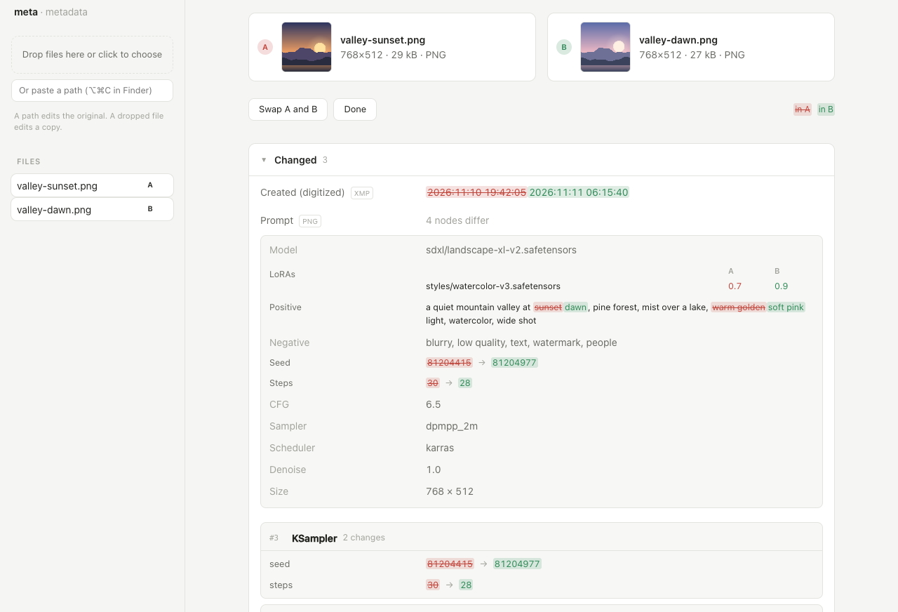

<h1 align="center">meta</h1>

<p align="center">
  See, compare, edit and strip the metadata in any image or video,<br>
  including the ComfyUI prompts hidden inside your renders.<br>
  One Python file on top of exiftool. Nothing leaves your Mac.
</p>

<p align="center">
  
  
  
  
</p>

<p align="center">
  <picture>
    <source media="(prefers-color-scheme: dark)" srcset="docs/compare-dark.png">
    
  </picture>
</p>

## Features

### Any file exiftool can read

Photos, RAW, HEIC, PNG, video, audio, and anything else [exiftool](https://exiftool.org/#supported) understands: EXIF, XMP, IPTC, GPS, QuickTime, PNG text chunks and maker notes. Tags are grouped into plain sections instead of one long list:

| Section | For example |
|---|---|
| Location | GPS coordinates, city, country |
| Owner & device | Owner name, camera and lens serial numbers |
| Dates | Taken, created, modified, time zones |
| Camera | Make, model, lens, aperture, shutter, ISO |
| Video & audio | Duration, frame rate, codecs, channels |
| AI generation | ComfyUI prompt and workflow, generation parameters |
| Description & rights | Title, caption, keywords, copyright |

Location and owner details come first, because they're what you usually want to check before sharing a file. The raw exiftool tags are one click away.

### ComfyUI prompts, readable

ComfyUI stores the full node graph as JSON in every PNG it saves. meta turns it back into something you can read:

- **Summary**: model, LoRAs with their strengths, positive and negative prompt, seed, steps, CFG, sampler, scheduler, denoise and size. Values wired in from other nodes (primitives, text concatenation, math nodes) are followed back to their source, so you see the value that was actually used.
- **One section per node**: each node shows its ID, type and inputs, for both the `prompt` and the `workflow` JSON.
- **Editable**: change any node value, a prompt word or a seed, and save. Everything else in the JSON stays byte-for-byte the same, including large seeds.

### Compare two files

Pick a second file and meta shows them side by side as A and B:

- **Changed, Only in A, Only in B, Same**: every field sorted by how it differs.
- **Inside long fields**: word-level highlights show exactly what changed in a prompt or caption, not just that it changed.
- **ComfyUI renders**: the summary diff shows the seed, steps and LoRA strengths that changed, and the node diff lists only the nodes and inputs that differ. Useful for finding why two renders from the same workflow look different.

### Edit and strip

- **Edit** any writable field or add a new one, review a list of changes, then save.
- **Strip** single fields, or everything with **Strip all**. The color profile and orientation are kept, so the picture still looks right.
- **Backups**: before any change to a file on disk, a copy goes to the Trash. See [How your files are treated](#how-your-files-are-treated).

## Requirements

- macOS (previews use Quick Look; backups use the Trash)
- Python 3.9 or newer (`python3 --version`)
- [exiftool](https://exiftool.org): `brew install exiftool`

## Install

```sh
git clone https://github.com/r1ckrck/meta.git
cd meta
./install.sh
```

`install.sh` copies `meta.py` to `~/tools/meta.py` and adds this line to `~/.zshrc`:

```sh
alias meta="python3 ~/tools/meta.py"
```

Open a new terminal afterwards. Using bash instead of zsh? Add the same line to `~/.bashrc`.

## Use

| Command | What happens |
|---|---|
| `meta` | Starts meta in the background and opens it in your default browser. The terminal is free right away. |
| `meta photo.jpg clip.mov` | Same, with those files loaded. If meta is already running, the files go to it: a fresh tab comes to the front and the old one closes. |
| `meta stop` | Stops it. |

In the page you can also drop files in, or paste a path into the path box.

meta stops itself after an hour with no meta tab open. An open tab, even in the background, keeps it running. If it stops while a tab is open, the tab says so; run `meta` again.

## How your files are treated

| Opened by | Saving does |
|---|---|
| Path (`meta <file>` or the path box) | Edits the file in place. Before each write, a backup copy named `name (meta backup <date time>).ext` goes to the Trash, so Finder's **Put Back** restores it. |
| Dropping onto the page | Works on a copy. The original is never touched; use **Download copy** to keep the result. |

## Privacy and security

- The server listens on `127.0.0.1` only, so nothing outside your Mac can reach it.
- Every request needs a random token created at start-up, and requests with a foreign `Host` header are refused. Other websites open in your browser can't read or change your files through it.
- Nothing is uploaded anywhere. All reading and writing is done by exiftool on your machine.

## Files it creates

All in the per-user temp folder (`$TMPDIR`), removed or overwritten as it runs:

| File | Purpose |
|---|---|
| `meta.log` | Output and errors of the background server. Check here if `meta` won't start. |
| `meta-instance.json` | Port and token of the running meta, so a second `meta` can hand files to it. Removed on stop. |
| `meta-XXXX/` | Working copies of dropped files and previews. Removed on stop. |

## Development

Edit `meta.py` in this repo, then test it in the terminal:

```sh
meta stop                                    # otherwise files are handed to the installed one
META_FOREGROUND=1 python3 meta.py [file ...] # runs in the terminal; Ctrl-C to stop
```

When it works, run `./install.sh` to update `~/tools/meta.py`. It also stops a running meta so the next `meta` uses the new code.

Environment variables:

| Variable | Effect |
|---|---|
| `META_FOREGROUND=1` | Run the server in the terminal instead of the background. |
| `META_NO_BROWSER=1` | Don't open a browser tab (for scripted tests). |

### How it works

- **One file.** `meta.py` holds the Python server and the page (HTML, CSS, JS) as a string. Python's standard library only.
- **Server.** A `ThreadingHTTPServer` on port 8765 (or the next free one up to 8784). The page calls JSON endpoints: `/api/read`, `/api/write`, `/api/strip`, `/api/remove`, `/api/open`, `/api/upload`, `/api/handoff`, `/api/ping`, plus `/api/preview/<id>` and `/api/download/<id>`.
- **exiftool.** Reads with `-json -G1` (each tag prefixed by its group, such as `EXIF:Model`). Writes with `-overwrite_original` after the Trash backup. Strip all keeps the ICC profile and orientation. ComfyUI's PNG text chunks aren't tags exiftool knows, so meta writes a small exiftool config that declares them and retries.
- **Previews.** Images the browser can show are served as they are; anything else (HEIC, RAW, video) gets a Quick Look thumbnail via `qlmanage`.
- **JSON values.** Number text is kept exactly (large seeds, `8.0`), and saving keeps the original spacing style, so an edited ComfyUI prompt differs from the original only where you changed it.
- **ComfyUI summary.** Starts from the Save/Preview node, follows its inputs back to the sampler, and resolves wired values through primitive, concat and math nodes. LoRAs are collected along the model chain (standard LoRA loaders and Power Lora Loader).
- **Background mode.** `meta` starts a detached copy of itself with `META_FOREGROUND=1`, waits until it is listening, and returns. `meta stop` sends it SIGTERM. Open tabs ping every minute; after an hour without a ping the server stops itself.
- **One instance.** A second `meta` finds the running one through `meta-instance.json` and posts its files to `/api/handoff`. The new tab announces itself on a `BroadcastChannel`, and the old tab closes (unless it has unsaved edits).

## License

MIT, see [LICENSE](LICENSE).
